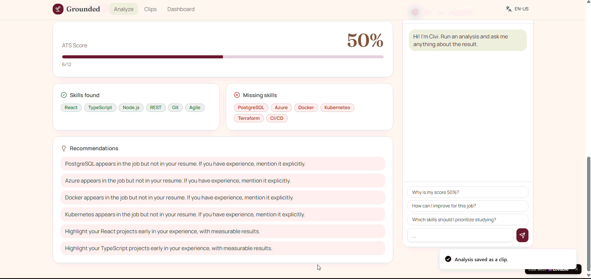
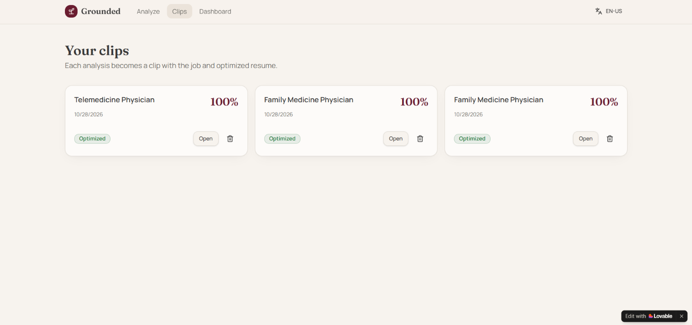
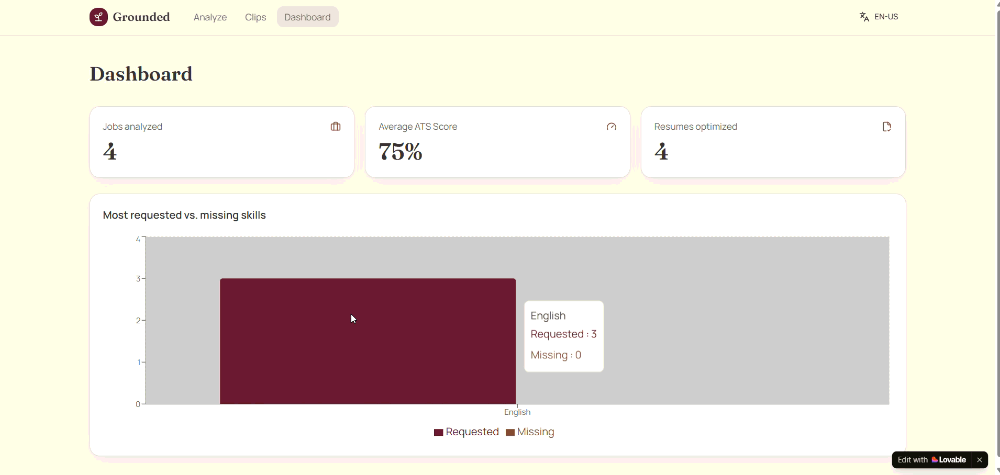

# Grounded: Vibe Coding for an ATS Resume Optimization Platform

  <a href="./README.md">
    <button>Portuguese Version</button>
  </a>

## Project Description

Grounded is a SaaS platform designed to help job seekers increase their chances of success in recruitment processes through intelligent resume optimization for ATS (Applicant Tracking Systems).

The MVP aims to provide resume analysis, assess ATS-friendliness, and organize applications and resumes for each job opportunity.

Users can test the platform within seconds using pre-configured job postings and resumes, analyze ATS compatibility, identify missing skills, generate an optimized version of their resume, and export an ATS-friendly version ready for submission.

### Slogan

> Turn job openings into opportunities.

---

## Single Prompt

[Project Single Prompt](prompt.en.md)

---

## Main Features

### Local ATS Analysis

- Automatic extraction of job requirements and skills
- Resume-to-job description comparison
- ATS Score calculation (0 to 100%)
- Identification of matched skills
- Identification of missing skills
- Automatic improvement recommendations

### Resume Optimization

- Intelligent skill prioritization
- Highlighting of the most relevant technologies and competencies
- Side-by-side comparison between the original and optimized resume
- Visual representation of changes
- ATS-friendly PDF export via browser printing

### Civi Assistant

Integrated contextual assistant capable of answering questions such as:

- Why is my score X%?
- How can I improve my resume?
- Which skills should I prioritize learning?
- What am I missing for this position?

### Analytics Dashboard

Real-time insights including:

- Jobs analyzed
- Average ATS Score
- Optimized resumes
- Analysis history
- Most requested skills
- Most common missing skills

### Clips System

Each analysis can be saved as a clip containing:

- Job information
- Original resume
- Optimized resume
- Analysis status

Local persistence using `localStorage` (first project iteration).

---

## Technologies and Tools Used

| Category | Tool |
|-----------|-----------|
| Frontend | React |
| UI Components | shadcn/ui |
| Local Storage | localStorage |
| Assisted Development | Lovable |
| AI for planning and documentation | ChatGPT |
| AI for development support | GitHub Copilot |
| Version Control | GitHub |
| IDE | Visual Studio Code |

---

## Project Architecture

### Core Services

#### AtsAnalyzer

Responsible for:

- Keyword extraction
- Skill identification
- ATS Score calculation
- Insight generation

#### ResumeOptimizer

Responsible for:

- Skill reorganization
- Experience prioritization
- ATS-friendly optimization
- Resume comparison

#### Civi Assistant

Responsible for:

- Explaining results
- Contextual recommendations
- Learning suggestions
- Job-fit guidance

---

## Prompts Used

| Stage | Purpose |
|---------|----------|
| Single Prompt | Complete creation of the Grounded functional MVP |
| Design System | Definition of a visual identity inspired by Notion, Linear, and Stripe |
| ATS Engine | Creation of AtsAnalyzer and ResumeOptimizer services |
| Dashboard | Development of analytics indicators and charts |
| Civi Assistant | Local contextual assistant implementation |
| Internationalization | PT-BR and EN-US implementation |
| Persistence | Data storage using localStorage (temporary) |
| Export | ATS-friendly PDF resume generation |

---

## Design System

### Color Palette

| Color | Hex |
|---------|---------|
| Burgundy | #6D1F33 |
| Earth Brown | #8B5E3C |
| Concrete Gray | #A7A6A1 |
| Charcoal | #3A3A3A |
| Light Beige | #EAE3D9 |
| Background | #F7F3EE |

### Characteristics

- Minimalist
- Professional
- Responsive
- Light Mode
- Dark Mode
- Rounded corners
- Soft shadows
- Accessibility-focused

---

## Project Differentiators

### Main Differentiator

- Productivity-oriented platform that reduces repetitive tasks related to resume customization and job application tracking.

### Additional Differentiators

- Automatically optimized resumes
- Visual comparison between resume versions
- Integrated analytics dashboard
- Persistent history
- Multilingual experience
- Clear and focused purpose: Grounded is not a social network or a job board. Its goal is to help candidates understand, improve, and manage their job applications efficiently.
- Practical and accessible ATS analysis: transforms job descriptions into actionable insights, highlighting matching skills, knowledge gaps, and opportunities for resume improvement.

---

## Results

### Testing ATS Analysis

### Clips Area (CVs and Job Positions)

### Dashboard

---

## What I Learned

Throughout this project, I had the opportunity to practice and deepen knowledge in:

- Prompt engineering for Vibe Coding
- AI-assisted prototyping
- SaaS application design
- ATS-friendly experience design
- Internationalization (i18n)
- Service-based frontend architecture
- Local persistence using localStorage
- React component-based development
- Analytics dashboard creation
- User experience for recruitment processes

---

## Next Steps

- Supabase integration
- Authentication system (name, profession, email, password)
- Add a back (←) navigation button
- Premium subscription plan
- Real PDF and DOCX upload support

# More Advanced Improvements

- Allow job applications to be tracked automatically and display candidate progression within the recruitment process inside the "Clips" section.

---

## Conclusion:

Grounded was developed as an experiment in AI-assisted software engineering, exploring Vibe Coding tools as a mechanism for prototyping, validating ideas, and accelerating requirement discovery.

Rather than treating AI as a rapid software development solution, this project approached AI as a support tool during product conception, enabling ideas to be transformed into functional prototypes capable of validating assumptions, user flows, business rules, and user experiences in a relatively short period of time.

Throughout development, it became clear that AI-generated software does not replace the fundamentals of Software Engineering. On the contrary, skills such as requirements modeling, software architecture, user experience design, business rule validation, critical thinking, and technical review remain essential to ensure product quality and consistency.

Grounded demonstrates how technology professionals can use AI to reduce the time between concept and validation while keeping engineering principles at the center of the process. In this context, AI acts as a productivity and creativity multiplier for software engineers rather than a replacement for software development expertise.

As an MVP, the project validates the concept of helping candidates optimize resumes for ATS systems while also serving as a practical case study on the use of AI throughout the digital product prototyping lifecycle.

---

# Check out my other Vibe Coded apps  

<a><button  cursor="pointer">My Other Related Projects</button><a>
