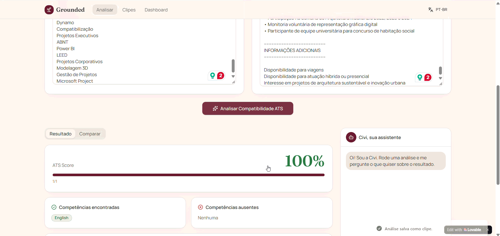
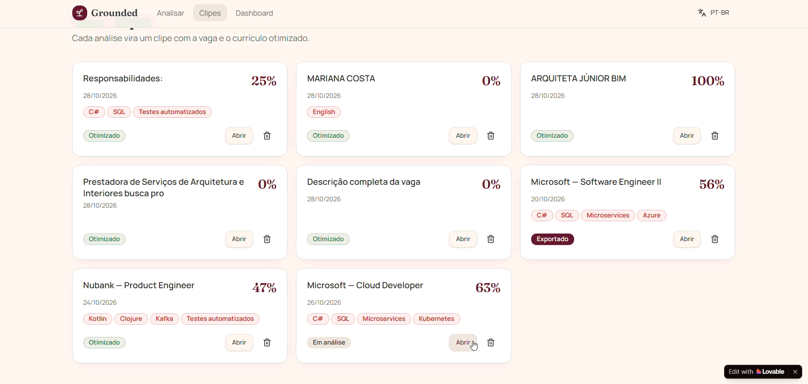
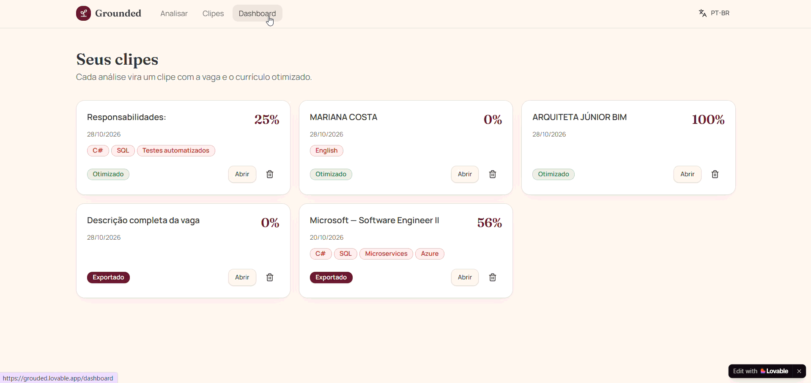

# Grounded: Vibe Coding for an ATS Resume Optimization Platform

  <a href="./README.en.md">
    <button>English Version</button>
  </a>

## Descrição do Projeto

O Grounded é uma plataforma SaaS desenvolvida para ajudar candidatos a aumentarem suas chances de aprovação em processos seletivos através da otimização inteligente de currículos para sistemas ATS (Applicant Tracking Systems).

A proposta do MVP é oferecer uma análise de currículos, medindo seu nível de ATS friendly e armazenar de modo organizado as candidaturas e currículos para cada vaga.

O usuário pode testar o sistema em segundos utilizando vagas e currículos pré-configurados, analisar compatibilidade ATS, identificar competências ausentes, gerar uma versão otimizada do currículo e exportar uma versão ATS-friendly pronta para envio.

### Slogan

> Transforme vagas em oportunidades.

---

## Prompt único:

[Prompt único do projeto](prompt.md)

---

## Funcionalidades Principais

### Análise ATS Local

- Extração automática de competências da vaga
- Comparação entre descrição da vaga e currículo
- Cálculo de ATS Score (0 a 100%)
- Identificação de competências encontradas
- Identificação de competências ausentes
- Recomendações automáticas de melhoria

### Currículo Otimizado

- Reordenação inteligente de competências
- Destaque das tecnologias mais relevantes para a vaga
- Comparação lado a lado entre currículo original e otimizado
- Visualização das alterações realizadas
- Exportação ATS-Friendly para PDF via impressão

### Assistente Civi

Chat contextual integrado que responde perguntas como:

- Por que meu score ficou em X%?
- Como melhorar meu currículo?
- Quais competências devo estudar?
- O que está faltando para esta vaga?

### Dashboard de Análises

Indicadores em tempo real:

- Vagas analisadas
- ATS Score médio
- Currículos otimizados
- Histórico de análises
- Competências mais exigidas
- Competências ausentes mais frequentes

### Sistema de Clipes

Cada análise pode ser salva como um clipe contendo:

- Dados da vaga
- Currículo original
- Currículo otimizado
- Status da análise

Persistência local utilizando `localStorage` (Primeira iteração do projeto)

---

## Tecnologias e Ferramentas Utilizadas

| Categoria | Ferramenta |
|------------|------------|
| Frontend | React |
| UI Components | shadcn/ui |
| Persistência Local | localStorage |
| Desenvolvimento Assistido | Lovable |
| IA para planejamento e documentação | ChatGPT |
| IA para suporte ao desenvolvimento | GitHub Copilot |
| Controle de versão | GitHub |
| IDE | Visual Studio Code |

---

## Arquitetura do Projeto

### Serviços Principais

#### AtsAnalyzer

Responsável por:

- Extração de palavras-chave
- Identificação de competências
- Cálculo do ATS Score
- Geração de insights

#### ResumeOptimizer

Responsável por:

- Reorganização de competências
- Priorização de experiências
- Otimização ATS-Friendly
- Comparação curricular

#### Civi Assistant

Responsável por:

- Explicação dos resultados
- Recomendações contextuais
- Sugestões de estudo
- Orientação sobre adequação à vaga

---

## Prompts Utilizados

| Etapa | Objetivo |
|---------|----------|
| Prompt Único | Criação completa do MVP funcional Grounded |
| Design System | Definição da identidade visual inspirada em Notion, Linear e Stripe |
| ATS Engine | Criação dos serviços AtsAnalyzer e ResumeOptimizer |
| Dashboard | Construção dos indicadores e gráficos analíticos |
| Civi Assistant | Implementação do assistente contextual local |
| Internacionalização | Implementação de PT-BR e EN-US |
| Persistência | Armazenamento de dados em localStorage (Temporariamente)|
| Exportação | Geração de currículo ATS-Friendly para PDF |

---

## Design System

### Paleta de Cores

| Cor | Hex |
|------|------|
| Vinho | #6D1F33 |
| Marrom Terroso | #8B5E3C |
| Cinza Concreto | #A7A6A1 |
| Carvão | #3A3A3A |
| Bege Claro | #EAE3D9 |
| Background | #F7F3EE |

### Características

- Minimalista
- Profissional
- Responsivo
- Light Mode
- Dark Mode
- Bordas arredondadas
- Sombras suaves
- Foco em acessibilidade

---

## Diferenciais do Projeto

### Diferencial principal

- Plataforma orientada à produtividade: reduz atividades repetitivas relacionadas à adaptação de currículos e ao acompanhamento de processos seletivos.

### Outros diferenciais

- Currículo otimizado automaticamente
- Comparação visual entre versões
- Dashboard analítico integrado
- Histórico persistente
- Experiência multilíngue
- Foco claro e objetivo: o Grounded não tenta ser uma rede social ou um portal de vagas. Seu propósito é ajudar candidatos a entender, melhorar e organizar suas candidaturas de forma eficiente.
- Análise ATS prática e acessível: transforma descrições de vagas em insights acionáveis, destacando competências compatíveis, lacunas de conhecimento e oportunidades de melhoria no currículo.

---
## Resultados

### Testando Análise ATS

### Área de armazenamento de currículos e vagas

### Dashboard

---

## O Que Aprendi

Durante o desenvolvimento deste projeto foi possível praticar e aprofundar conhecimentos em:

- Engenharia de prompts para Vibe Coding
- Prototipação com IA
- Estruturação de aplicações SaaS
- Design de experiências ATS-Friendly
- Internacionalização (i18n)
- Arquitetura Frontend baseada em serviços
- Persistência local com localStorage
- Componentização com React
- Construção de dashboards analíticos
- UX para processos seletivos

## Próximos Passos

- Integração com a Supabase;
- Login (nome, profissão, email, senha);
- Adicionar botão de voltar (←) ou (back);
- Plano Premium;
- Upload real de PDF e DOCX.

# Refinamentos mais complexos:

- Fazer com que a vaga seja rastreada e o posicionamento do candidato no processo da vaga apareça na área "Clips".

## Conclusão

O Grounded foi desenvolvido como um experimento de engenharia assistida por IA, explorando o uso de ferramentas de Vibe Coding como mecanismo de prototipação, validação de ideias e aceleração da descoberta de requisitos.

Mais do que uma ferramenta de desenvolvimento rápido, a IA foi utilizada como apoio ao processo de concepção do produto, permitindo transformar uma ideia em um protótipo funcional capaz de testar hipóteses, fluxos de navegação, regras de negócio e experiências de usuário em um curto espaço de tempo.

Durante o projeto, ficou evidente que a geração de software por IA não substitui os fundamentos da Engenharia de Software. Pelo contrário, competências como modelagem de requisitos, arquitetura, experiência do usuário, validação de regras de negócio, pensamento crítico e revisão técnica continuam sendo essenciais para garantir qualidade e coerência no produto final.

O Grounded demonstra como profissionais de tecnologia podem utilizar IA para reduzir o tempo entre concepção e validação de um produto, permitindo focar mais na resolução de problemas reais e menos na implementação inicial de protótipos. Nesse contexto, a IA atua como uma ferramenta de amplificação da produtividade e da criatividade do engenheiro, e não como substituta do processo de desenvolvimento.

Como MVP, o projeto valida a proposta de auxiliar candidatos na otimização de currículos para sistemas ATS, ao mesmo tempo em que serve como estudo prático sobre a aplicação de IA no ciclo de prototipação de produtos digitais.

---
# Meus outros Projetos de Vibe Coding

<a><button  cursor="pointer">Meus outros projetos de Vibe Coding</button><a>
